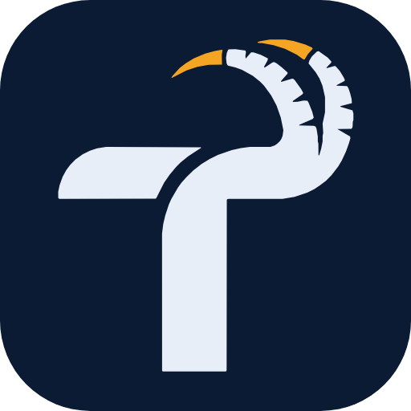

<p align="center"></p>

# TGoat

TGoat is a bot that plays your OGame accounts. It is the successor of TBot 3.6 and ogamed: one program that holds both the game client and the bot, with a web interface you open on your computer, and control from Telegram or Discord.

**Read the guide: [ronnie32.github.io/tgoat](https://ronnie32.github.io/tgoat/)**

> **Beta: `0.1.0-beta.2`.** Expect bugs, and back up `config/` and `data/` before each update. Using a bot breaks OGame's rules (Gameforge's terms of use): your account can be banned. Use it at your own risk, ideally on a secondary account, and start with every feature off.

## What it does

- **Defends** your planets: watches for attacks every 1 to 5 minutes, saves the fleet before impact, and keeps watching while you sleep.
- **Grows** your account: mines, research, lifeforms, storage and energy, each build chosen by how fast it pays back.
- **Raids** inactive players with AutoFarm, ranks targets by profit per hour, and can propose the fleet that opens a defended target, with its payback.
- **Sends** expeditions, harvests debris, colonizes and explores, and collects the Directives rewards.
- **Explains** itself: every decision comes with its reason, in the logs and the web interface.

Nearly every behaviour is a setting. A setup assistant reads your account and suggests settings that fit it; nothing is applied without your click.

## Where to start

- **New to TGoat:** [Get started](https://ronnie32.github.io/tgoat/start.html), then the [web interface](https://ronnie32.github.io/tgoat/interface.html).
- **Coming from TBot 3.6:** your settings are imported on the first start. Read [What changes for you](https://ronnie32.github.io/tgoat/from-tbot.html).
- **Looking something up:** [settings](https://ronnie32.github.io/tgoat/settings.html), [commands](https://ronnie32.github.io/tgoat/commands.html), [every change from TBot](https://ronnie32.github.io/tgoat/changes.html), [known limits](https://ronnie32.github.io/tgoat/limits.html).

## Downloads

Download TGoat from the [Releases](https://github.com/ronnie32/tgoat/releases) page: one archive per system (Windows, Linux, macOS; amd64 or arm64). Unpack it in a folder of its own and start `tgoat` (`tgoat.exe` on Windows); [Get started](https://ronnie32.github.io/tgoat/start.html#install) has the rest. Once it runs, TGoat tells you about new versions and can install them itself (see [Updates](https://ronnie32.github.io/tgoat/start.html#updates)). The history of each version is in [CHANGELOG.md](CHANGELOG.md).

## Docker

The image `ghcr.io/ronnie32/tgoat` (linux/amd64 and linux/arm64) holds the program of each release, after its signature and checksums are checked ([docker/](docker/), [workflow](.github/workflows/docker.yml)). With Docker Compose:

```
mkdir tgoat && cd tgoat && mkdir config data log
curl -fsSLO https://raw.githubusercontent.com/ronnie32/tgoat/main/docker/docker-compose.yml
docker compose up -d
docker compose exec tgoat tgoat webui password
```

Then open `http://localhost:9090` and sign in. [Run TGoat in Docker](https://ronnie32.github.io/tgoat/start.html#docker) covers the game sign-in, HTTPS with Caddy and updates (`docker compose pull && docker compose up -d`).

## Signed releases

Every release is signed. `checksums.txt` lists the SHA-256 of each archive, and `checksums.txt.sig` is its ed25519 signature (base64) by the TGoat release key. TGoat installs an update only if both check out, and never an older version.

To check a release by hand (OpenSSL 3; the one shipped with Git for Windows works), save the public key below as `tgoat-release.pub`, download the archive, `checksums.txt` and `checksums.txt.sig`, then run:

```
base64 -d checksums.txt.sig > checksums.sig.bin
openssl pkeyutl -verify -pubin -inkey tgoat-release.pub -rawin -in checksums.txt -sigfile checksums.sig.bin
sha256sum --ignore-missing -c checksums.txt
```

The second command must print `Signature Verified Successfully`, the third `OK` for your archive. On macOS use `shasum -a 256 --ignore-missing -c checksums.txt`. On Windows, `certutil -decode checksums.txt.sig checksums.sig.bin` replaces the first command, and `Get-FileHash <archive>` gives the SHA-256 to compare.

Release public key:

```
-----BEGIN PUBLIC KEY-----
MCowBQYDK2VwAyEAJqTZcwxwgqfnDlIxRMFkuQUjV943CFRAdmui/BHT66U=
-----END PUBLIC KEY-----
```

`tgoat version` prints the SHA-256 of the key built into your copy: `9918d9c3ebba3283d19cc048395047f11f24756c6a1ea0abfebd63236b68dfdf`. `openssl pkey -pubin -in tgoat-release.pub -outform DER | sha256sum` gives the same value for the key above.

## A note from the author

Many of TGoat's decisions come from my own reading of the game: its rules, my understanding of the meta, and how a careful player would play. I did my best with all of that, and tested in the game what could be tested. I do not promise that every decision is the best one, or that it makes sense in every situation of your account. If a choice does not suit you, the settings let you change it.

Zeus (`zeus8000` on Discord)

## Credits

TGoat's game client derives from [alaingilbert/ogame](https://github.com/alaingilbert/ogame) (MIT licence). TGoat follows TBot 3.6 (C#), whose settings it imports.
